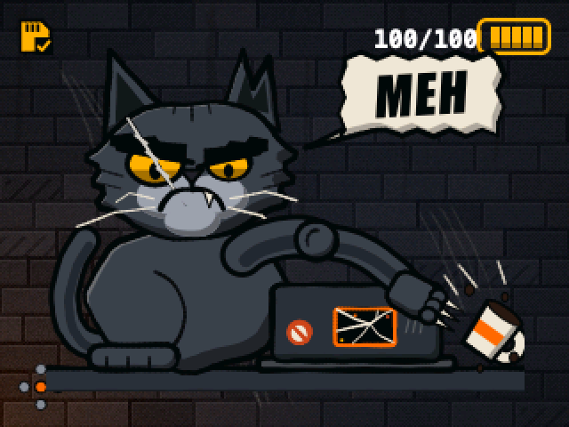
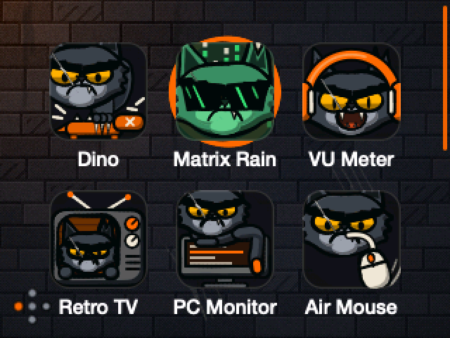
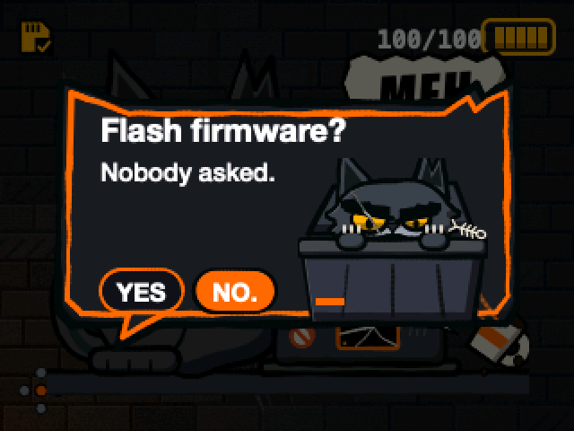
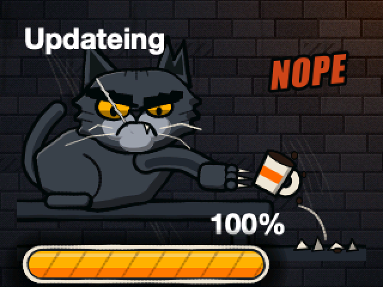

# GrumpyKitty

Community firmware for the MeowKit-S3 (ESP32-S3-WROOM-1-N16R8): more apps, bug fixes and a grumpy alley-cat theme. Unofficial fork of the MeowKit-S3 firmware by Mingo / Whitecliff, see [NOTICE.md](NOTICE.md).

[](https://buymeacoffee.com/jclima)
[](CONTRIBUTING.md)

| Home | Apps | Dialogs | Update |
|---|---|---|---|
|  |  |  |  |

## Features

- All the vendor apps, plus a scrollable apps menu (up to 24 apps).
- **Media Remote** and **Slide Clicker**: BLE HID remotes.
- **Radio Scanner Plus**: passive Wi-Fi and BLE survey, Wi-Fi channel counts, signal tracking, CSV export, and Grumpy Scout.
- **Voice Recorder**: WAV files on the SD card.
- **Boat Dash**: read-only Signal K dashboard with alarms.
- Infrared: Flipper `.ir` files parsed and saved correctly (bounded parsing, proper protocol names).
- Fixes: SD cards in unsupported formats are reported clearly, battery monitoring and shutdown logic made robust, Wi-Fi credentials no longer stored in plaintext, race conditions in USB MSC and system sound, UI typos and overflows. Full list in [CHANGELOG.md](CHANGELOG.md).

## Flash it

Always power the device **off** first and enter Download Mode (below). Flashing does not touch the SD card.

**a) From the browser (easiest).** Desktop Chrome or Edge: <https://jclima.github.io/grumpykitty-firmware/flash/> (available once GitHub Pages is enabled for the repository).

The browser flasher writes only the bootloader, partition table, `boot_app0` and firmware regions, so saved settings are kept as long as you leave **Erase device** unticked. A future settings-format change may still need an erase or a migration. The merged image in (b) wipes saved settings, because it also overwrites the settings area with blank data.

**Partition table change (dual OTA slots).** This release replaces the single 12.5 MB app partition with two 7.5 MB slots (`app0` and `app1`), preparing for over-the-air updates in a later release. The firmware is about 5.8 MB, so it fits a slot with room to spare. Moving a device from the old table needs this one release flashed once more by the browser flasher or wired (esptool); no full erase is needed, and saved settings stay because the settings (NVS) partition does not move, so leave **Erase device** unticked. A device cannot change its own partition table over the air, so this step can never be done remotely.

**b) With esptool (clean install; wipes settings).** Download `grumpykitty-X.Y.Z-merged.bin` from [Releases](https://github.com/jclima/grumpykitty-firmware/releases):

```
python -m esptool --chip esp32s3 write_flash 0x0 grumpykitty-X.Y.Z-merged.bin
```

**c) From source** (needs PlatformIO, see [DEVELOPMENT.md](DEVELOPMENT.md)):

```
make bootstrap-check && make upload
```

### Download Mode

1. Power off. Push a Dupont jumper wire through the hole on the back to hold BOOT.
2. While holding BOOT, hold Power for 1-2 s.
3. Release Power, then release BOOT. The screen stays off.
4. Connect USB-C directly to the computer (no hub) with a data cable. The port shows as "USB JTAG/serial debug unit".

### After flashing

Hold Power for 4-5 s to power off, then press Power to boot (or briefly short RESET to GND). Saved settings such as Wi-Fi are wiped by a full-chip erase and by flashing the merged image; updating from GrumpyKitty builds with the browser flasher (Erase unticked) keeps them.

## SD card

Format the card as **FAT32 with an MBR** partition table (exFAT is not supported), then copy the contents of the `sd files/` folder to its root. On macOS: Disk Utility > View > Show All Devices > select the card (the device, not the volume) > Erase > Format `MS-DOS (FAT)`, Scheme `Master Boot Record`.

## Radio Scanner Plus quick start

Open **Radio Scan+** from the apps menu. Use Left and Right to switch between Wi-Fi, Channels, Grumpy Scout, and BLE. On a Wi-Fi or BLE list, highlight a device and press **A** to track its signal. Press **B** to go back or open the survey actions, where you can pause, resume, or export the current results to `/surveys` on the SD card. Hold **B** to exit.

The Channels view counts access points seen on each channel. Grumpy Scout reacts to Wi-Fi survey results. Each CSV is a snapshot of the current Wi-Fi or BLE results and includes device identifiers.

From a Wi-Fi view, press **B** and select **Wi-Fi packet monitor**. Use Up and Down to pick a setting and Left and Right to change it. Choose the current channel or select a 2.4 GHz channel allowed by the device's Wi-Fi region. While connected to an access point, use its current channel. Turn on **Save to microSD** and choose a PCAP filter to record all management frames, beacons, probes, or deauthentication and disassociation frames. The live counters show all observed management frames regardless of the file filter.

Press **A** to start, then **A** again to stop and finalize the capture. Hold **B** to stop and exit the app. Finished captures appear in `/captures` on the FAT32 microSD card and open in Wireshark. The monitor itself only listens. An existing Wi-Fi connection stays active on its channel, and any channel change the monitor made while disconnected is restored on stop. Captures include network and device identifiers.

Capture stops and saves the file if the radio changes channel or the file reaches its 16 MiB limit. PCAP stores up to 512 bytes per management frame. If the system clock is unset, capture timestamps show time since boot.

## Boat Dash quick start

Create `/grumpykitty/signalk.json` on the SD card (or rely on mDNS discovery) and open Boat Dash from the apps menu. It is read-only and sends no commands. Config keys, the mock server and tokens are covered in [DEVELOPMENT.md](DEVELOPMENT.md).

## Building and contributing

`make build`, `make upload`, `make monitor` and `make dist` are described in [DEVELOPMENT.md](DEVELOPMENT.md); releases in [docs/RELEASING.md](docs/RELEASING.md). Security issues: see [SECURITY.md](SECURITY.md).

Pull requests and feature requests are welcome. The cat grumbles, but he reads everything. Got an idea? [Open a feature request](https://github.com/jclima/grumpykitty-firmware/issues/new/choose). Want to send code? See [CONTRIBUTING.md](CONTRIBUTING.md). Bug reports with a serial log (`make monitor`) are gold.

## Support

If GrumpyKitty saved you a trip to the boat, [buy the cat a coffee](https://buymeacoffee.com/jclima). He won't thank you, but I will.

## License

Mixed licensing, read [NOTICE.md](NOTICE.md). In short:

- JC Lima's contributions are MIT ([LICENSE-MIT](LICENSE-MIT)).
- Upstream vendor code carries no explicit license and is not relicensed here.
- Third-party libraries keep their own licenses. ESP32-audioI2S (GPL-3.0) is linked into the firmware, so anyone distributing binaries must offer the corresponding source; IRremoteESP8266 is LGPL-2.1.
- "MeowKit" is the vendor's trademark. This is an unofficial community fork, not affiliated with or endorsed by the vendor.

Use security-related features (BadUSB, infrared, radio scanning) only on devices you own or are authorized to test.

## Credits

- [MeowKit-S3 firmware](https://github.com/mingolucky/meowkit-s3-firmware) by Mingo / Whitecliff Tech, the upstream project. Hardware docs, setup and product documentation: [docs.meowkit.cc](https://docs.meowkit.cc/).
- Libraries: LVGL, LovyanGFX, Mooncake, ArduinoJson, AnimatedGIF, ESP32-audioI2S, IRremoteESP8266, Lua, ESP32-BLE-Keyboard/Mouse and others under `lib/`.
- Web flashing: [ESP Web Tools](https://github.com/esphome/esp-web-tools) (Apache-2.0).
